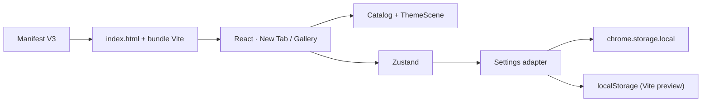

# Kiến trúc

## Phase 1

- `public/` chứa manifest, metadata en/vi và icon. Vite dùng đường dẫn tài nguyên tương đối để chạy tại origin của extension.
- `src/themeCatalog.js` định nghĩa theme gốc có ID ổn định. Cùng một ThemeScene dùng cho thẻ, xem thử và màn New Tab.
- `src/preferences.js` chuẩn hóa và đồng bộ qua storage change event. Mỗi tùy chọn có khóa riêng, mỗi mục yêu thích có khóa theo theme, và ID theme cùng bảng màu tùy chỉnh được ghi trong một bản ghi.
- New Tab là màn mặc định. Gallery và draft thuộc state giao diện của từng tab. Lỗi đọc hoặc ghi hiện trong giao diện.
- Chỉ xin quyền storage. Logic, theme và UI được đóng gói cùng extension. [Chrome page override](https://developer.chrome.com/docs/extensions/develop/ui/override-chrome-pages) · [Chrome storage](https://developer.chrome.com/docs/extensions/reference/api/storage) · [Manifest V3 security](https://developer.chrome.com/docs/extensions/develop/migrate/improve-security)

## Phase 2

- `src/studioRepository.js` quản lý IndexedDB. Một transaction xác minh asset, cập nhật nền đã lưu và ghi lựa chọn đang dùng. Transaction xóa ảnh kiểm tra toàn bộ nền đã lưu trước khi xóa ảnh gốc và thumbnail.
- `src/background.js` chuẩn hóa tham số. `ThemeScene` tái dùng renderer ở Studio, New Tab, gallery và popup xem thử. Ảnh gốc dùng object URL được thu hồi khi đổi ảnh hoặc đóng view. Thumbnail được tạo khi upload và giữ ổn định trong thư viện.
- BroadcastChannel thông báo sau commit để các tab đọc lại dữ liệu. chrome.storage.local tiếp tục lưu ngôn ngữ và yêu thích. Lựa chọn Phase 1 được đọc làm fallback khi IndexedDB chưa có bản ghi đang dùng.
- Studio chỉnh một nền cục bộ theo từng preset. Bản nháp ở state của tab, và lưu khi bấm áp dụng. Asset được kiểm tra lại ở thời điểm lưu để tránh tham chiếu rỗng nếu tab khác vừa xóa.

## Phase 3

- `src/typography.js` chuẩn hóa khối chữ và tra thư viện lời chào, thơ, châm ngôn. Nội dung do người dùng nhập được render dạng chuỗi React. Châm ngôn mỗi ngày tra theo ngày địa phương và locale, rồi cập nhật khi sang ngày mới hoặc quay lại tab.
- `ThemeScene` dùng `SceneText` chung cho trình chỉnh chữ, trình chỉnh nền, popup xem thử và New Tab. Khối trên/dưới đồng hồ co chữ theo chiều rộng khung và tự xuống dòng.
- Phase 2 và Phase 3 cùng dùng document theo preset. Transaction đọc bản ghi hiện tại rồi chỉ cập nhật phần đang chỉnh, giữ phần còn lại nếu tab khác vừa lưu. Document v1 được đọc với danh sách chữ rỗng và ghi dần sang v2. Schema kho IndexedDB giữ nguyên.

## Phase 4

- `canvasModel.js` chuẩn hóa layer và lưu lịch sử tối đa 80 bước. `canvasGeometry.js` chuyển đổi tọa độ, xử lý biến đổi nhóm, căn lớp và bám cạnh, tâm hoặc lưới.
- `useCanvasGesture.js` dùng Pointer Events và pointer capture. Khi mất capture trong lúc con trỏ còn nhấn, trình chỉnh sửa tiếp tục nhận sự kiện trong cửa sổ. Pointer up ghi một snapshot. Pointer cancel, nhả con trỏ ngoài cửa sổ, mất focus hoặc Escape bỏ bản xem trước.
- `SceneCanvas` dùng mặt phẳng 16:9 đặt giữa khung và cùng renderer trên editor, popup xem thử và New Tab. Lưới, đường căn và nút điều khiển chỉ thuộc giao diện chỉnh sửa.
- Canvas v3 được ghi cùng phần đang dùng trong transaction. Panel nền và panel chữ đọc canvas đã lưu và giữ nó khi áp dụng thay đổi. Xóa asset kiểm tra cả nền và lớp ảnh trước khi ghi.

## Phase 5

- `widgetModel.js` định nghĩa loại, cấu hình hợp lệ và hành vi timer. `Widgets.jsx` dựng cùng widget trong canvas và New Tab. Chế độ editor chỉ xem thử. New Tab bật tương tác và chuyển widget sang thẻ ở viewport hẹp.
- Layout presets thử vị trí mới và tỷ lệ thu nhỏ dựa trên các lớp đang hiện. Mỗi lần chèn cấp ID mới, rồi commit cả cụm vào lịch sử canvas.
- Repository thêm kho `widgetData` bằng migration IndexedDB v2. Todo cập nhật từng mục trong transaction. Notes ghi theo lần bấm Lưu. Timer lưu trạng thái cùng mốc đích. Sự kiện BroadcastChannel báo theo ID widget sau mỗi commit.
- Layout export chỉ lấy dữ liệu thiết kế đã chuẩn hóa. Nội dung riêng của widget nằm ngoài luồng này.

## Phase 6

- `EffectsStudio` xem trước hiệu ứng cùng `ThemeScene`. Một lớp CSS xử lý hoạt ảnh chữ và widget cho cả Canvas tự do và Tự sắp xếp. Hiệu ứng nền dùng lớp phủ, tối đa 24 hạt hoặc dịch nền theo con trỏ. Tab ẩn tạm dừng chuyển động trang trí.
- Store giải lịch theo giờ thiết bị và tải thiết kế theo ID. Khi lịch bật, áp dụng thủ công trong tab không đổi lựa chọn toàn hồ sơ. Thiết kế chỉnh sửa vẫn ghi vào IndexedDB và thông báo cho các tab khác sau commit.

## Ranh giới mở rộng

- Mở rộng ThemeDocument qua các Phase sau. IndexedDB migration dùng transaction nâng phiên bản. Phiên bản tài liệu JSON độc lập với phiên bản database.
- Phase 7 mở rộng layout export thành theme di động kèm asset. Backup mang thêm nội dung cá nhân.
- Phase 7 điều phối restore từ staging, kiểm tra toàn bộ tham chiếu, commit dữ liệu IndexedDB rồi đổi con trỏ đang dùng. Kế hoạch phục hồi mô tả trong DATA_SCHEMA.md.
